<p align="center">
  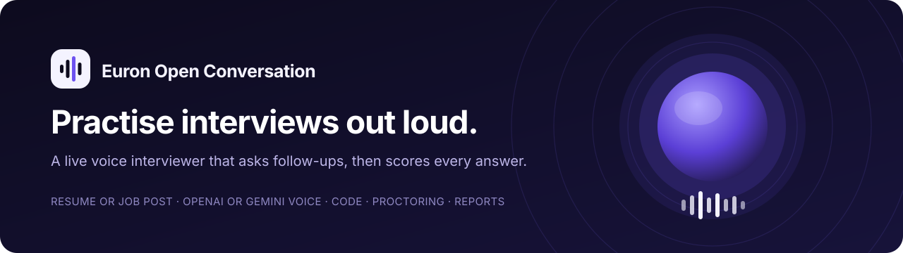
</p>

<p align="center">
  
  <a href="LICENSE"></a>
  
  
  
  
  
  
  
  
  
  
</p>

<p align="center">
  <a href="https://github.com/euron-sde-team/euron-open-real-time-ai-conversation-system/stargazers"></a>
  <a href="https://github.com/euron-sde-team/euron-open-real-time-ai-conversation-system/fork"></a>
  <a href="https://github.com/euron-sde-team/euron-open-real-time-ai-conversation-system/watchers"></a>
  <br>
  <a href="https://github.com/euron-sde-team/euron-open-real-time-ai-conversation-system/issues"></a>
  <a href="https://github.com/euron-sde-team/euron-open-real-time-ai-conversation-system/pulls"></a>
  <a href="https://github.com/euron-sde-team/euron-open-real-time-ai-conversation-system/commits/main"></a>
  
  <br>
  <a href="#built-by-the-team-behind-euron"></a>
</p>

<p align="center">
  <b><a href="#-quickstart">Quickstart</a></b> ·
  <b><a href="#️-architecture">Architecture</a></b> ·
  <b><a href="#-explore-the-repository">Explore the repo</a></b> ·
  <b><a href="docs/api/rest-contract.md">API reference</a></b> ·
  <b><a href="docs/api/realtime.md">Realtime</a></b> ·
  <b><a href="#️-deploy-to-aws">Deploy</a></b> ·
  <b><a href="docs/architecture/security.md">Security</a></b> ·
  <b><a href="#-documentation">Docs</a></b>
</p>

**Euron Open Conversation** is an open-source, self-hosted **AI mock interviewer you talk to**. Upload
a resume or paste a job description, and it writes a realistic interview plan: an introduction,
rounds on the candidate's own stack and projects, a coding round when the role calls for one,
behavioural questions and a closing round. Then an AI interviewer holds the interview out loud,
in real time, over **OpenAI Realtime** or **Gemini Live**: it asks each question, listens, asks two
to four follow-ups like a real interviewer, and moves on. Afterwards every answer is scored for
domain knowledge and communication, with strengths, gaps, concrete suggestions and, for code, a
corrected snippet. It is MIT-licensed and part of the open-source initiative of **ENGAGESPHERE
TECHNOLOGY PRIVATE LIMITED**.

Candidates can practise with **proctoring** (camera presence and tab checks that run in the browser,
with video never leaving the device), answer coding questions in an in-room editor, read a full
report with round-by-round scores and the transcript, download it as a PDF, and share it through a
revocable link. Admins run the deployment from an `/admin` control plane: users, monthly
allowances of interviews and voice minutes, text and voice models with prices for a cost estimate,
interview metadata (never transcripts), shared links, settings and the audit log.

The parts that usually go wrong in voice AI apps are designed in, not bolted on:

- **The server writes the interviewer, not the browser.** Instructions are built on the server from
  the stored plan and locked into a short-lived provider credential. The browser never sees a
  provider key and never sends instructions, so a candidate cannot turn the interviewer into a
  free general-purpose voice assistant.
- **Scores come from the server.** The browser reports what was said; a background job scores it
  with a text model. The API rejects any rating a client tries to send.
- **Voice time is measured and capped on the server.** Each session has a hard length from the
  monthly allowance, time is booked from the server's clock, abandoned sessions are swept, and
  OpenAI calls are hung up when their time is over.
- **Resumes are never stored.** A resume is read in memory, turned into a plan and a short summary,
  and dropped; the planning job's payload leaves the queue as soon as it finishes.

Everything runs on a laptop with no API key at all: a deterministic stand-in writes plans and
scores, and a stub interviewer speaks with the browser's own voice while you type or dictate. An
AWS emulator stands in for SES and Secrets Manager, and it deploys to AWS with the same Terraform.

<p align="center">
  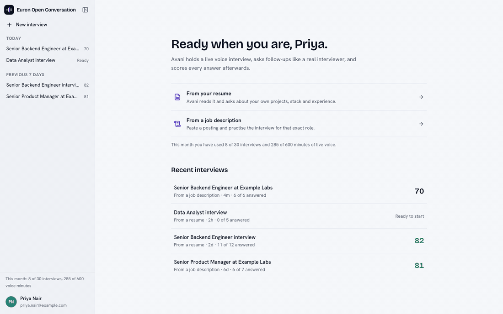
</p>

> [!NOTE]
> Everything in the tour and the screenshots ran for real on a laptop: the API's real provider
> adapters talking to the local stand-ins over the same wire formats the real providers use. The
> stub interviewer stands in for the realtime voice, which needs an OpenAI or Gemini key; add one
> and the same room holds the interview out loud. `make up && make demo` reproduces it.

<h3 align="center">Built by the team behind Euron</h3>

<p align="center">
  <sub>Euron Open Conversation is part of the open-source initiative of ENGAGESPHERE TECHNOLOGY PRIVATE LIMITED, made by the people who build<br>the platforms below. If you like how this repository is built, come and see what we build with it.</sub>
</p>

<p align="center">
  <a href="https://euron.one"><picture><source media="(prefers-color-scheme: dark)" srcset="docs/assets/brand/euron-dark.svg"></picture></a>
  <a href="https://euronsystems.com"><picture><source media="(prefers-color-scheme: dark)" srcset="docs/assets/brand/euron-systems-dark.svg"></picture></a>
  <a href="https://alphaeuron.com"><picture><source media="(prefers-color-scheme: dark)" srcset="docs/assets/brand/alpha-euron-dark.svg"></picture></a>
</p>

<p align="center">
  <a href="https://www.instagram.com/euron_official"></a>
  <a href="https://www.linkedin.com/company/euronone/posts/"></a>
  <a href="https://x.com/euron712"></a>
  <a href="https://www.youtube.com/@Euron-official"></a>
  <a href="https://whatsapp.com/channel/0029VaeeJwq9RZAfPW9P2l07"></a>
</p>

---

## 📚 Table of contents

- [Why Euron Open Conversation](#-why-euron-open-conversation)
- [At a glance](#-at-a-glance)
- [Screenshots](#️-screenshots)
- [Features](#-features)
- [Architecture](#️-architecture)
  - [One question, from credential to score](#one-question-from-credential-to-score)
  - [How each provider keeps the interviewer on script](#how-each-provider-keeps-the-interviewer-on-script)
  - [Data model](#data-model)
- [Tech stack](#-tech-stack)
- [Prerequisites](#-prerequisites)
- [Quickstart](#-quickstart)
- [Use real voice models](#-use-real-voice-models)
- [Explore the repository](#-explore-the-repository)
- [API](#-api)
- [Configuration](#️-configuration)
- [Deploy to AWS](#️-deploy-to-aws)
- [Security model](#-security-model)
- [Testing](#-testing)
- [Documentation](#-documentation)
- [Roadmap](#️-roadmap)
- [FAQ](#-faq)
- [Contributing, security and license](#-contributing-security-and-license)

---

## 💡 Why Euron Open Conversation

Practising an interview alone is hard: a list of questions does not push back, and recording
yourself does not ask "why that design?". Voice models can now hold a real conversation, but most
demos that wire one up hand the browser a key or let the page write the model's instructions, trust
whatever score the page reports, and count no minutes. That is fine for a demo and ruinous for a
deployment that anyone can sign up to.

Euron Open Conversation is a complete mock-interview product you run yourself, with those edges
done and tested:

- **Questions about you, not a textbook.** Plans name your projects, companies and stack (or the
  job's responsibilities), with a coding round for technical roles and descriptive round names.
  You can review and edit every question before you start.
- **An interviewer that listens.** Live voice with interruption, follow-ups that build on what you
  said, typed answers when speaking is not possible, and a code editor for coding questions.
- **Honest scores.** Server-side scoring on a published rubric, the same for every answer, with an
  empty answer scored at the floor, and feedback you can act on.
- **Costs you can control.** Monthly interviews and voice minutes by tier and per person, a hard
  session length, server-measured time, and an estimated cost per model on the admin overview.
- **Privacy by construction.** Resumes are never stored; admins see metadata, never transcripts;
  shared links leave the transcript out unless the owner includes it.

## 📊 At a glance

| | |
|---|---|
| **Apps** | Web app (Next.js) with the live room and the `/admin` control plane, API, background worker, and a stubs server standing in for the text and realtime providers |
| **Interviews** | Plans from a resume (PDF, DOCX) or a job description, editable before the start; rounds, follow-ups, coding questions, typed answers, pause and continue |
| **Voice** | OpenAI Realtime over WebRTC (handshake through the API's relay, which also works on networks that block the provider) and Gemini Live over WebSocket, with server-locked instructions |
| **Reports** | Overall, domain and communication scores per round and per question, feedback, corrected code, transcript, proctoring events, PDF export, revocable share links |
| **Proctoring** | Face presence with a self-hosted MediaPipe detector and tab checks, in the browser only; events on the report |
| **Control plane** | Users and roles, quota tiers and overrides, text and voice models with a test call and prices, settings and feature switches, interviews (metadata), shared links, audit log, usage and cost overview |
| **Mobile-ready API** | Native token mode, a DOM-free typed client, every flow over plain REST |
| **Tests** | 232 unit, 150 integration on real Postgres and Redis, 8 browser end-to-end |
| **License** | MIT |

## 🖼️ Screenshots

<table>
  <tr>
    <td width="50%">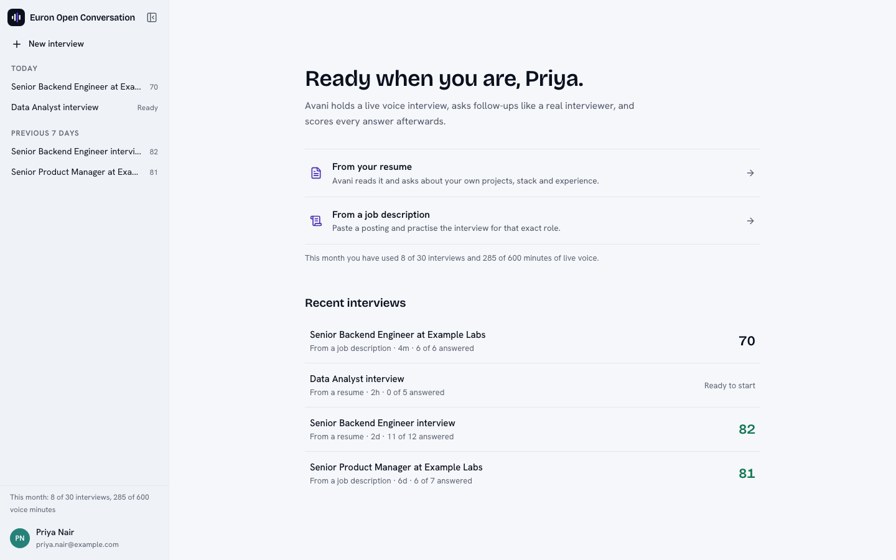<br><sub><b>Home.</b> Start from a resume or a job description; recent interviews with their scores.</sub></td>
    <td width="50%">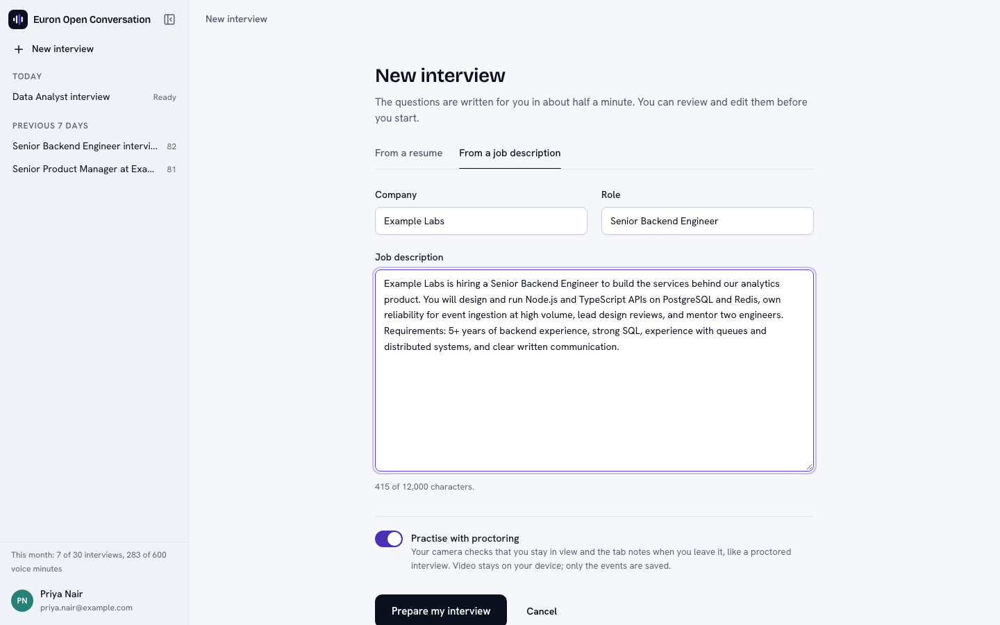<br><sub><b>New interview.</b> Paste a job description, or drop a resume that is read once and never stored.</sub></td>
  </tr>
  <tr>
    <td>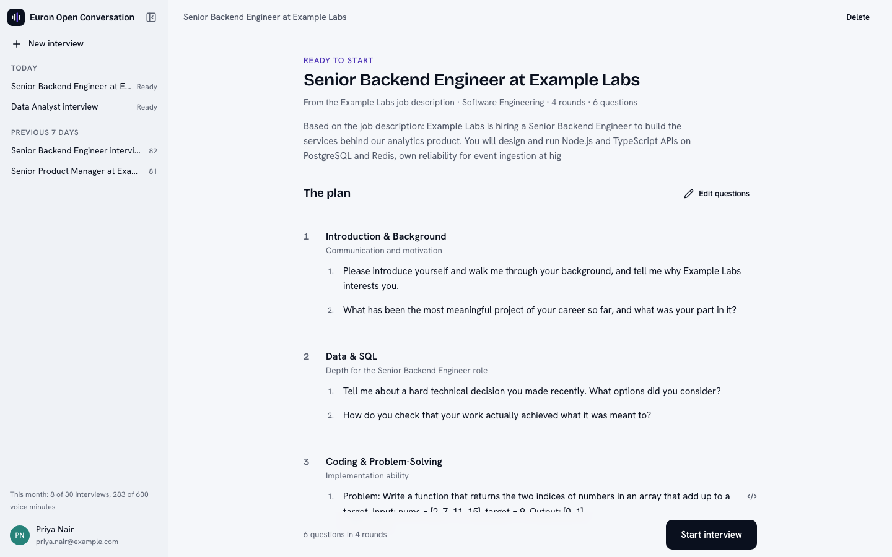<br><sub><b>The plan.</b> Rounds written for this job, every question editable before the start.</sub></td>
    <td>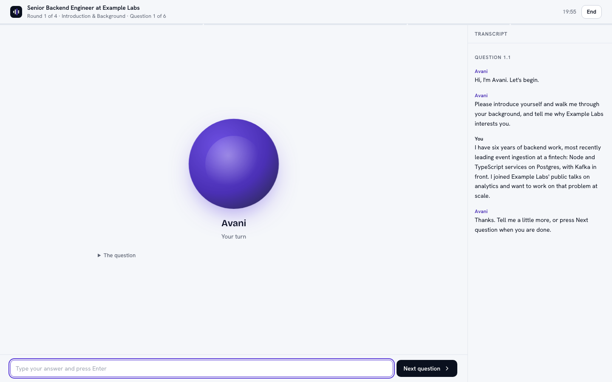<br><sub><b>The live room.</b> The interviewer asks and follows up; the transcript fills in as you speak.</sub></td>
  </tr>
  <tr>
    <td>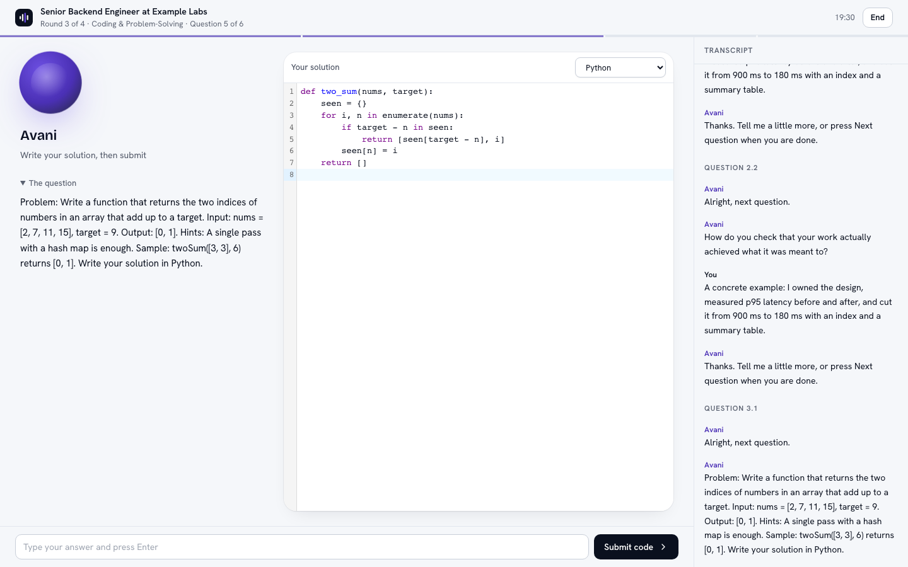<br><sub><b>Coding questions.</b> The problem beside an editor in the question's language.</sub></td>
    <td>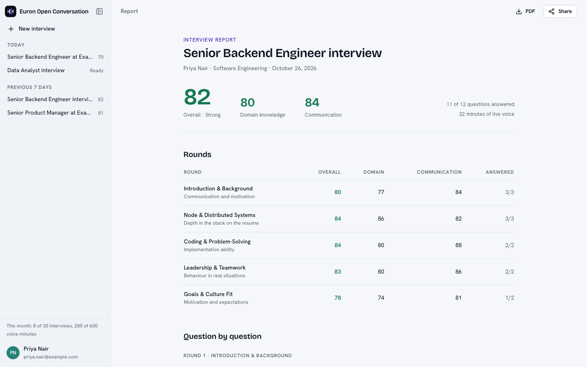<br><sub><b>The report.</b> Scores per round, then every question with feedback.</sub></td>
  </tr>
  <tr>
    <td>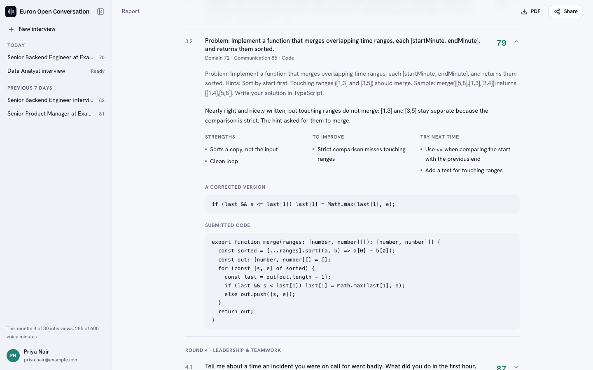<br><sub><b>Feedback.</b> Analysis, strengths, gaps, what to try next, and corrected code.</sub></td>
    <td>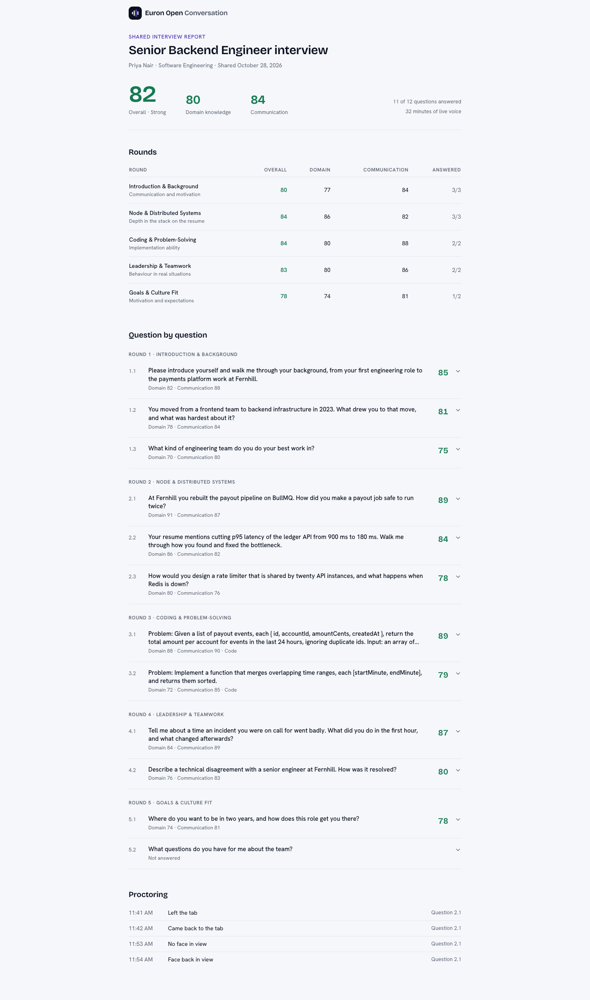<br><sub><b>Shared report.</b> A read-only link, transcript left out unless the owner includes it.</sub></td>
  </tr>
  <tr>
    <td>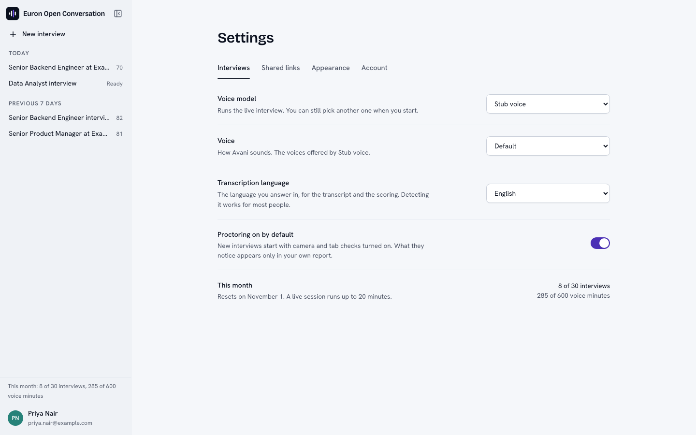<br><sub><b>Settings.</b> Voice model and voice, transcription language, proctoring default, shared links.</sub></td>
    <td>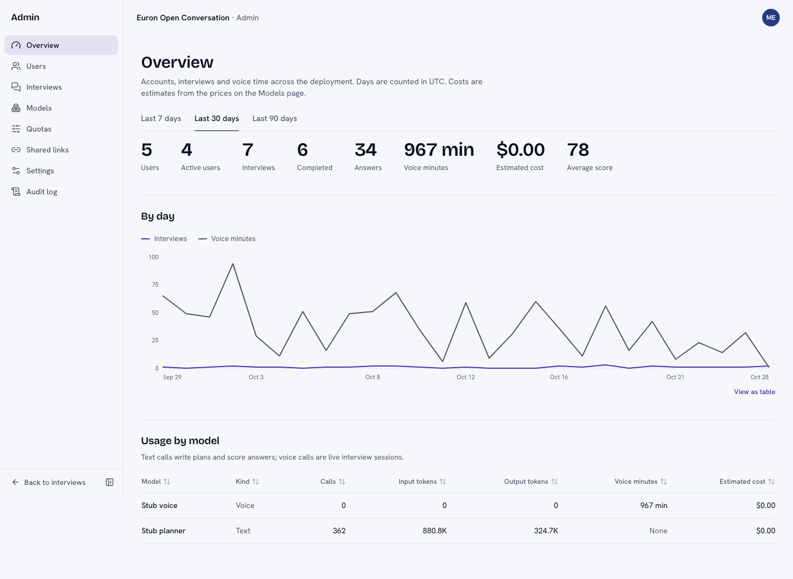<br><sub><b>Admin overview.</b> Interviews, voice minutes, estimated cost and usage by model.</sub></td>
  </tr>
  <tr>
    <td>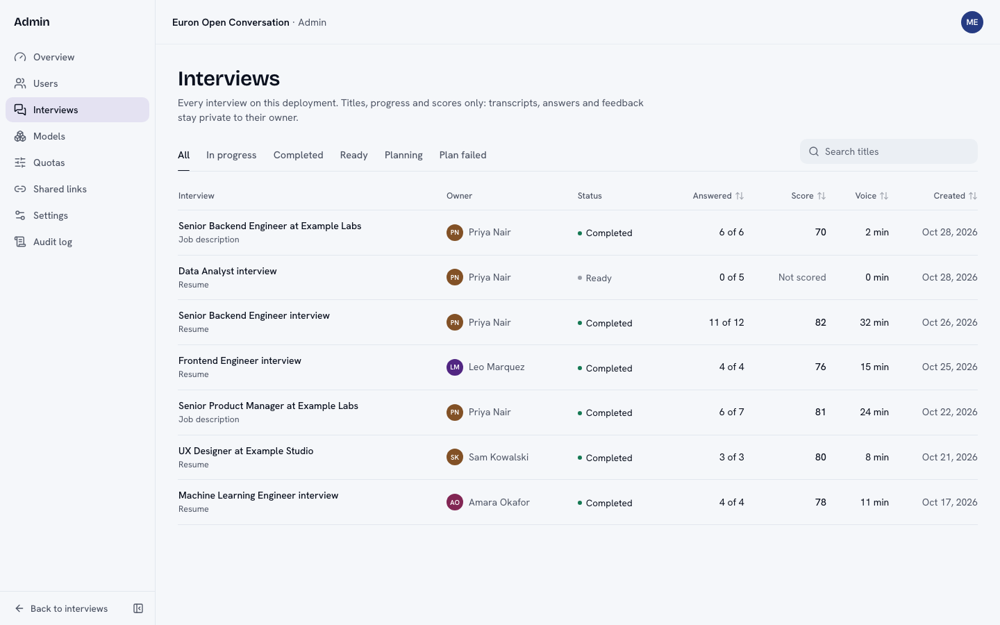<br><sub><b>Admin, Interviews.</b> Metadata only: transcripts and answers stay private.</sub></td>
    <td>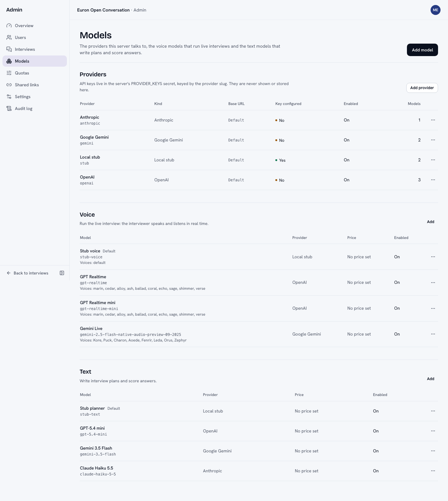<br><sub><b>Admin, Models.</b> Text models plan and score; voice models hold the interview.</sub></td>
  </tr>
  <tr>
    <td>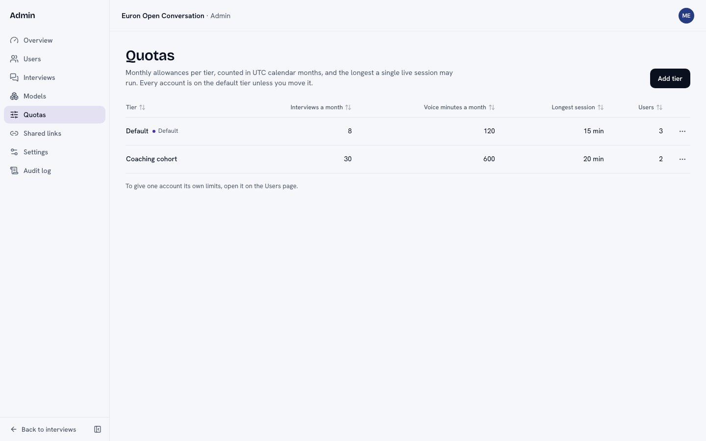<br><sub><b>Admin, Quotas.</b> Monthly interviews and voice minutes per tier, with per-person overrides.</sub></td>
    <td>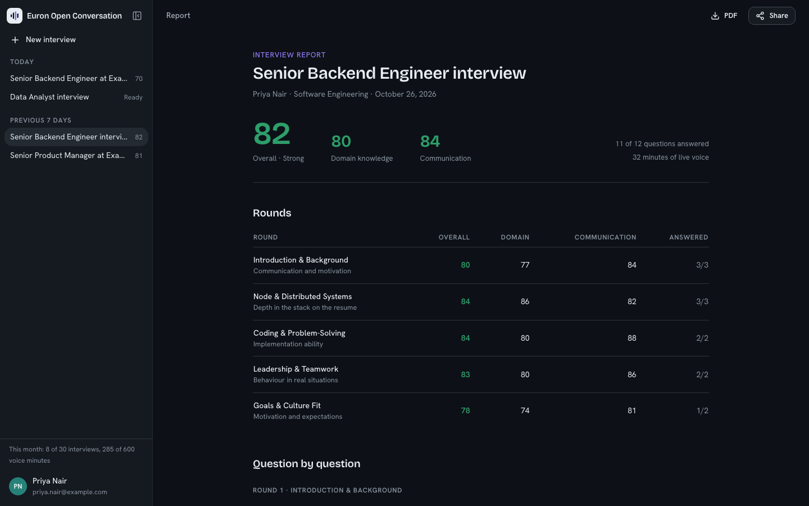<br><sub><b>Dark mode.</b> Every screen, as a token swap.</sub></td>
  </tr>
</table>

## ✨ Features

**For candidates**

- Plans from a resume (PDF or DOCX, checked by its bytes) or from a company, role and job description;
  round names that say what each round is about; edit, add or remove questions before the start.
- A live voice interview: the interviewer greets you, asks, listens with server voice activity
  detection, follows up and moves on; say "next question" or press the button any time.
- Typed answers instead of speaking, a pause that keeps your place, and a clock per question.
- Coding questions in a CodeMirror editor (Python, JavaScript, TypeScript, Java, C++, Go, SQL), reviewed
  for correctness, complexity and edge cases, with a corrected snippet when one helps.
- Optional proctoring: face presence and tab checks, events on the report, video never uploaded.
- A report with overall, domain and communication scores, a row per round, feedback per question,
  the transcript and submitted code, a PDF, and share links with optional expiry.
- Settings for the voice model, the voice, the transcription language and the proctoring default;
  account security with two-step sign-in, sessions, data export and account deletion.

**For admins**

- Users, roles, suspensions and bans; quota tiers with monthly interviews, voice minutes and a
  maximum session length, plus per-person overrides.
- Providers and models: TEXT models write plans and score answers, REALTIME models hold the
  interview; voices per model; prices per million tokens and per voice minute for the cost estimate;
  a Test button that makes a real call or mints a real credential.
- The interviewer's name and house rules, feature switches (resume upload, job descriptions, code
  questions, proctoring, sharing, PDF export), registration mode, retention.
- An overview of users, interviews, answers, voice minutes, average score and estimated cost; the
  interviews list (metadata only); shared links with revoke; the audit log.

## 🏗️ Architecture

<p align="center">
  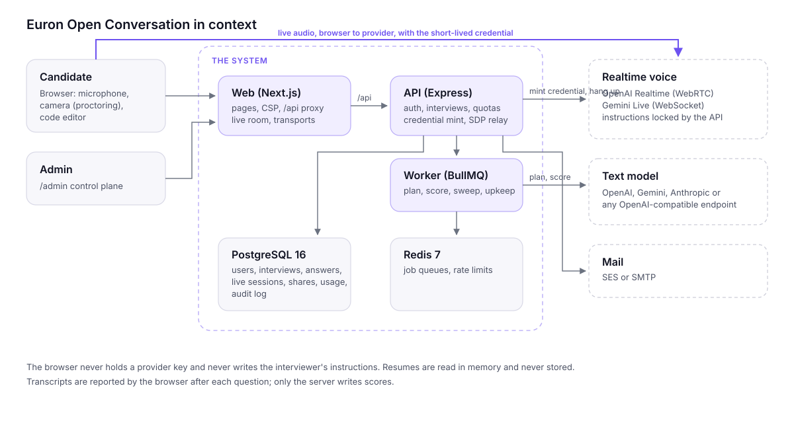
</p>

One TypeScript monorepo, one API image with three commands (API, worker, migrations), one web image.
The browser talks only to the web origin, which proxies `/api` to the API, so the refresh cookie is
first-party. Live audio is the exception: it flows between the browser and the voice provider,
authorised by a credential the API minted seconds earlier for exactly one question.

### One question, from credential to score

<p align="center">
  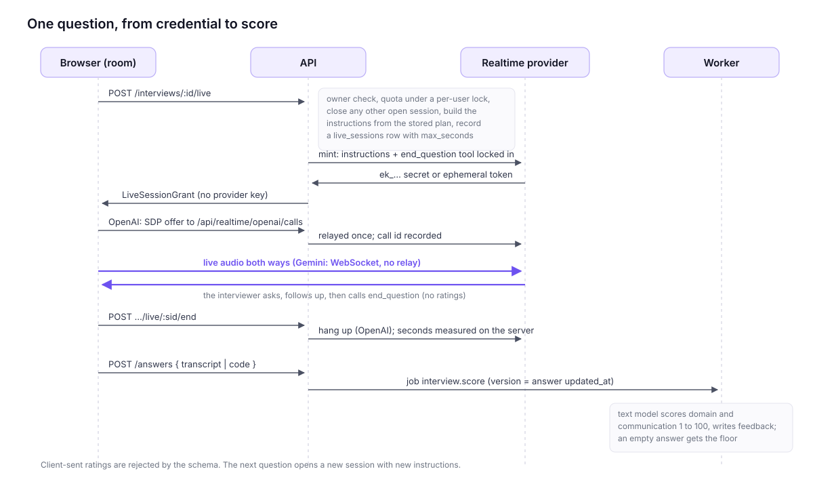
</p>

1. `POST /api/interviews/:id/live` checks the owner and the monthly voice allowance under a
   per-user advisory lock, closes any other open session of that person, builds the interviewer's
   instructions from the stored plan and the running summary, and mints a credential that expires
   for new connections within two minutes.
2. The browser connects: OpenAI over plain WebRTC with the SDP offer sent to the API's relay (which
   records the call id), Gemini Live over its WebSocket with a one-use ephemeral token, or the local
   stub.
3. The interviewer asks, follows up and calls `end_question`, a tool with no arguments. Or the
   candidate presses Next question, or the question's time runs out.
4. The browser ends the session; the API books the seconds it measured and hangs up the OpenAI call.
   Then it posts the transcript (or the code), and a worker job scores it.

### How each provider keeps the interviewer on script

| Provider | Credential | Instructions | Session length |
|---|---|---|---|
| OpenAI Realtime | `client_secrets` with the full session: model, instructions, the tool, voice, transcription, server VAD | Set by the server. The web client never sends `session.update`; OpenAI does not lock the session, so a determined user could change it from developer tools, which the threat model covers | The server hangs the call up at the end, at the session's maximum, or when the sweeper expires it |
| Gemini Live | A one-use ephemeral token with `liveConnectConstraints` and locked fields | Locked by Google: a different config from the browser is ignored | The token expires at the session's maximum |
| Stub | A signed local token | The server sends the lines to speak | Ended by the browser or the sweeper |

Details, and why the OpenAI transport is a hundred lines of WebRTC instead of an SDK:
[docs/architecture/realtime-and-providers.md](docs/architecture/realtime-and-providers.md).

### Data model

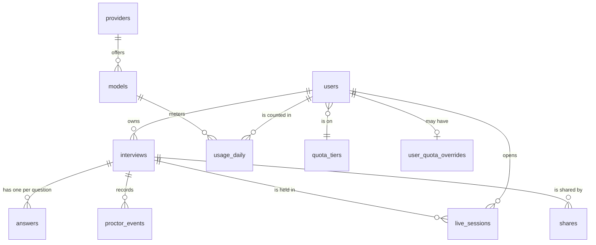

`interviews.plan` holds the rounds as JSON and freezes when the first live session opens.
`answers` holds one row per question, written by the browser's submit and scored only by the worker.
`usage_daily` holds counts and seconds, never text, so deleting an interview never gives quota back.
Every table: [docs/architecture/data-model.md](docs/architecture/data-model.md).

## 🧰 Tech stack

| Layer | Choice |
|---|---|
| Web | Next.js 15 (App Router), React 19, TanStack Query, Radix UI, Tailwind CSS, CodeMirror 6 |
| Voice in the browser | Plain WebRTC for OpenAI Realtime, `@google/genai` for Gemini Live, Web Speech for the stub |
| Proctoring | MediaPipe face detector, WebAssembly served from the app's own origin |
| API | Node.js 22, Express 5, Kysely on PostgreSQL 16, zod, pdfkit |
| Jobs | BullMQ on Redis 7 |
| Text models | OpenAI, Anthropic and Gemini native APIs, and the OpenAI-compatible format, through plain `fetch` |
| Documents | unpdf and mammoth, in memory |
| Mail | Amazon SES (or SMTP, or a local outbox) |
| Infrastructure | Terraform, ECS Fargate, ALB, CloudFront and WAF, RDS, ElastiCache, KMS, SES, Secrets Manager, CloudWatch |
| Local AWS | The Floci emulator (SES, KMS, Secrets Manager) and Mailpit |
| Tooling | pnpm workspaces, Turborepo, TypeScript strict, Vitest, Playwright, ESLint |

## 📋 Prerequisites

- Docker with Compose v2 (about 4 GB of memory for the containers)
- Node.js 22 and pnpm 9 (only to run tests or develop outside Docker)
- For real voice: an OpenAI or Gemini API key; a browser with a microphone (and a camera for
  proctoring)
- For AWS: an account, a domain in Route 53 with an ACM certificate, and Terraform 1.10 or later

No AWS account and no model key are needed to run it locally.

## 🚀 Quickstart

```bash
git clone https://github.com/euron-sde-team/euron-open-real-time-ai-conversation-system.git
cd euron-open-real-time-ai-conversation-system
make up      # the stack on emulated AWS, provisioned by the same Terraform as production
make demo    # demo people, two finished interviews with reports, one plan ready to start
```

Open http://localhost:3550 and sign in as `priya.nair@example.com` (finished interviews and a plan
ready to start) or `admin@example.com` (the control plane) with the password `make demo` prints.
Every demo account shares it.

| URL | What |
|---|---|
| http://localhost:3550 | The app (and `/admin`) |
| http://localhost:5046/api/ready | The API readiness check |
| http://localhost:8066 | Mailpit: every email the app sends |
| http://localhost:5139 | The stubs: text model and realtime credential stand-ins |

Locally the planner and scorer are deterministic stand-ins and the interviewer is the stub voice,
so you can try every screen without a key. `make help` lists every target;
[docs/guides/quickstart-local.md](docs/guides/quickstart-local.md) explains each step.

## 🎙️ Use real voice models

1. Put a key in `deploy/compose/.env`: `OPENAI_API_KEY=sk-...` and or `GEMINI_API_KEY=...`, or
   several at once with `PROVIDER_KEYS={"openai":"sk-...","gemini":"..."}`.
2. `make up` again. The starter catalogue already lists `gpt-realtime`, `gpt-realtime-mini` and
   Gemini Live, plus text models for planning and scoring; a provider appears as soon as its key is
   configured.
3. In **Admin, Models**, choose the default voice and text models, add prices if you want a cost
   estimate, and press **Test**: for a voice model it mints a real credential without opening a call.

Use headphones: the browser's echo cancellation does most of the work, headphones do the rest.
Details for every provider: [docs/guides/providers.md](docs/guides/providers.md).

## 🧭 Explore the repository

```
apps/
  api/          Express API and worker (one image, two commands)
    src/
      routes/                 every endpoint, with its contract in a doc comment
      services/interview/     plans, prompts, live sessions, answers, reports, PDF
      integrations/realtime/  OpenAI client secrets and hang-up, Gemini ephemeral tokens, stub
      integrations/llm/       text models: OpenAI, Anthropic, Gemini, OpenAI-compatible
      jobs/                   plan, score, hang up, sweep, upkeep
  web/          Next.js: the app, the live room, the shared report, /admin
    src/lib/realtime/         the three browser transports and proctoring
  stubs/        dependency-free provider stand-ins for development and tests
packages/
  types/        the API contract
  api-client/   typed client for web and React Native
  ui/           design tokens and primitives
db/migrations/  one SQL migration
deploy/compose/ the local stack (Floci, Mailpit, stubs)
infra/          Terraform modules and environments, Dockerfiles
docs/           architecture, ADRs, API, guides
e2e/            Playwright end-to-end tests
```

[docs/guides/walkthrough.md](docs/guides/walkthrough.md) follows one interview from the upload to
the report, naming every file on the way.

## 🔌 API

- [REST contract](docs/api/rest-contract.md): envelopes, error codes, pagination, auth modes and
  rate limits.
- [Realtime](docs/api/realtime.md): live session grants, the three transports, the SDP relay, and
  ending a question.
- [OpenAPI 3.1](docs/api/openapi.yaml): 78 operations, generated from the route files
  (`pnpm openapi`, checked in CI with `--check`).
- [`@open-conversation/api-client`](packages/api-client): the typed client the web app uses, ready
  for a mobile app.

```bash
# Plan an interview from the command line
TOKEN=$(curl -s localhost:5046/api/auth/login -H 'content-type: application/json' \
  -d '{"login":"priya.nair@example.com","password":"<demo password>"}' | jq -r .accessToken)
curl -s localhost:5046/api/interviews/from-job-description -H "authorization: Bearer $TOKEN" \
  -H 'content-type: application/json' \
  -d '{"company":"Example Labs","role":"Backend Engineer","jobDescription":"Build Node.js services on Postgres, own reliability for payment flows, and mentor two engineers."}'
```

## ⚙️ Configuration

Every variable is declared once in [`apps/api/src/core/config.ts`](apps/api/src/core/config.ts) and
documented in [docs/guides/configuration.md](docs/guides/configuration.md). A production API refuses
to boot with development secrets, a localhost web URL, missing CORS origins, mail to a local outbox
or inline jobs.

## ☁️ Deploy to AWS

```bash
make aws-plan ENV=aws-dev     # terraform plan for infra/terraform/envs/aws-dev
make aws-deploy ENV=aws-dev   # build and push images, apply, run migrations
```

ECS Fargate behind one load balancer, RDS PostgreSQL, ElastiCache Redis, SES, Secrets Manager and
KMS, with CloudFront and WAF optional in dev and on in prod. Provider keys live in Secrets Manager,
never in the database. [docs/guides/deploy-aws.md](docs/guides/deploy-aws.md) walks through the first
deploy and [docs/guides/operations.md](docs/guides/operations.md) through running it.

## 🔐 Security model

- **Ownership is a 404.** Every interview, answer, live session, report and share route is scoped by
  owner; another person's interview does not exist for you.
- **Admins cannot read interviews.** The control plane shows metadata, counts and scores; there is no
  endpoint that returns someone's summary, answers or transcript.
- **Untrusted text is fenced.** Resumes, job descriptions and transcripts reach a model inside a
  marked block it is told to treat as material, never as instructions, and every model output is
  checked by a schema before it is stored.
- **Keys never reach the browser.** Provider keys come from the environment or Secrets Manager; the
  browser gets a credential for one question that expires within minutes.
- **Strict headers.** A per-request Content-Security-Policy with a nonce, `wasm-unsafe-eval` only for
  the face detector, `connect-src` limited to the realtime origin, and camera and microphone
  allowed for this origin only.

The full picture, including what is not enforceable (a candidate can type a different transcript of
their own answer; an OpenAI session can be altered from developer tools until the server hangs it
up): [docs/architecture/security.md](docs/architecture/security.md) and
[docs/architecture/threat-model.md](docs/architecture/threat-model.md).

## 🧪 Testing

```bash
pnpm lint && pnpm typecheck && pnpm test        # unit tests in every package
make test-integration                          # the API against real Postgres and Redis
make e2e                                       # Playwright against the running stack
```

| Suite | Count | Where |
|---|---|---|
| API unit | 84 | `apps/api/test/unit` |
| API integration | 150 | `apps/api/test/integration`, against Postgres 16 and Redis 7 with the stubs in-process |
| Web unit and components | 95 | `apps/web/test` |
| API client and UI kit | 47 | `packages/api-client/test`, `packages/ui/test` |
| Stubs | 6 | `apps/stubs/test` |
| End to end | 8 | `e2e/tests`, Chromium against the stack on the stub voice, including an axe accessibility check |

The integration suite proves the guarantees above: another user gets 404 on every interview route,
a client cannot send ratings or instructions, the instructions locked into an OpenAI client secret
come from the stored plan, parallel requests cannot draw past a quota, voice time is capped and
measured on the server, and no response or table ever contains a provider key.
[docs/guides/testing.md](docs/guides/testing.md) has the details.

## 📖 Documentation

| | |
|---|---|
| Architecture | [HLD](docs/architecture/HLD.md), [LLD](docs/architecture/LLD.md), [interview engine](docs/architecture/interview-engine.md), [realtime and providers](docs/architecture/realtime-and-providers.md), [data model](docs/architecture/data-model.md), [quotas](docs/architecture/quotas.md) |
| Security | [security](docs/architecture/security.md), [threat model](docs/architecture/threat-model.md) |
| Decisions | [architecture decision records](docs/architecture/adr) |
| API | [REST contract](docs/api/rest-contract.md), [realtime](docs/api/realtime.md), [OpenAPI](docs/api/openapi.yaml) |
| Guides | [quickstart](docs/guides/quickstart-local.md), [configuration](docs/guides/configuration.md), [providers](docs/guides/providers.md), [deploy to AWS](docs/guides/deploy-aws.md), [operations](docs/guides/operations.md), [testing](docs/guides/testing.md), [troubleshooting](docs/guides/troubleshooting.md), [walkthrough](docs/guides/walkthrough.md), [mobile clients](docs/guides/mobile-clients.md) |

## 🗺️ Roadmap

- A server sideband for OpenAI sessions, so the server can also watch and correct the live session.
- Interviewer personas and difficulty levels chosen per interview.
- A React Native client on the existing native token mode and API client.
- Panel interviews with more than one interviewer voice.

## ❓ FAQ

<details>
<summary><b>Do I need an API key to try it?</b></summary>

No. `make up && make demo` runs everything with deterministic stand-ins: plans and scores come from
the stubs server and the interviewer speaks with your browser's built-in voice while you type or
dictate. A real voice interview needs an OpenAI or Gemini key.
</details>

<details>
<summary><b>Which models can I use?</b></summary>

For the live interview, OpenAI Realtime models (`gpt-realtime`, `gpt-realtime-mini`) and Gemini Live
models. For planning and scoring, any OpenAI, Anthropic or Gemini text model, or anything that
speaks the OpenAI chat format (OpenRouter, Groq, a local Ollama).
</details>

<details>
<summary><b>Is my resume stored?</b></summary>

No. It is read in memory to write the plan and a short summary for the interviewer, then dropped.
The text passes through the job queue only until the planning job finishes. You can regenerate a
plan from a job description, but not from a resume, for that reason.
</details>

<details>
<summary><b>Can admins listen to or read my interview?</b></summary>

No. Audio never reaches the server at all: it goes from your browser to the voice provider.
Transcripts are stored for your report, and only you (and whoever you share a link with, if you
include the transcript) can read them. Admins see titles, counts, scores and minutes.
</details>

<details>
<summary><b>Does proctoring upload my video?</b></summary>

No. The face detector runs in your browser. Only events such as "no face in view" or "left the tab"
are sent, with their time and question, and they appear on your report.
</details>

<details>
<summary><b>My network blocks the voice connection. What can I do?</b></summary>

For OpenAI the handshake goes through this app's own origin, which fixes networks that only block
the provider's API domain. Networks that block WebRTC media altogether (some VPNs and corporate
firewalls) need another network; a phone hotspot usually works.
[docs/guides/troubleshooting.md](docs/guides/troubleshooting.md) has more.
</details>

## 🤝 Contributing, security and license

- [CONTRIBUTING.md](CONTRIBUTING.md): how to set up, the checks a pull request must pass, and the
  coding conventions.
- [SECURITY.md](SECURITY.md): how to report a vulnerability privately.
- [CODE_OF_CONDUCT.md](CODE_OF_CONDUCT.md).
- [MIT License](LICENSE).
