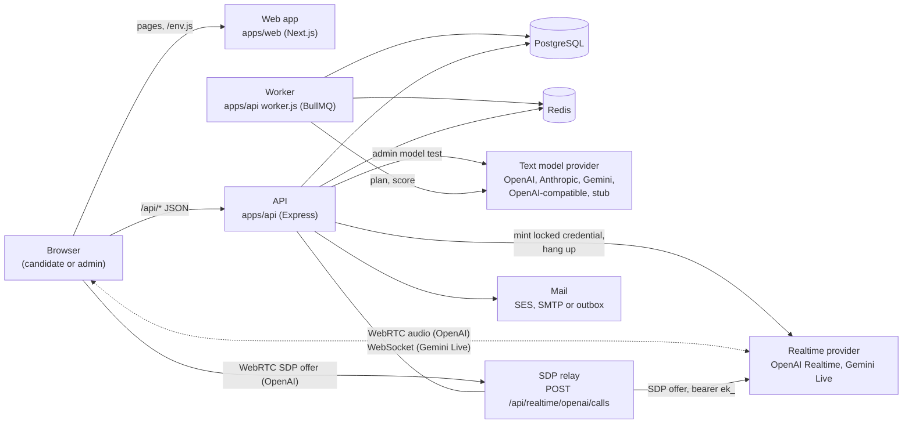

# High-level design

Euron Open Conversation is a self-hosted AI mock-interview system over live voice. A
candidate uploads a resume or pastes a job description, a text model writes an interview
plan (rounds of questions), and a realtime voice model holds the interview one question
at a time in the browser. After each question the server scores the answer with the text
model. The candidate gets a report with ratings, feedback, the transcript and, when
proctoring is on, what the camera and tab checks saw. Reports can be exported as PDF or
shared through revocable links.

One deployment serves one organisation or community ([ADR 0002](adr/0002-single-tenant.md)).
Admins run it from `/admin` in the same web app: accounts, quota tiers and overrides,
providers and models, deployment settings, interview metadata, share links and the audit
log. Admins never read anyone's answers or transcripts.

This page describes what runs, where data lives and how a request travels. Deeper topics:

| Topic | Page |
| --- | --- |
| Modules and request flows inside the API and the web app | [LLD.md](LLD.md) |
| Plans, prompts, untrusted fencing, scoring | [interview-engine.md](interview-engine.md) |
| Realtime providers, locked instructions, session length and hang-up | [realtime-and-providers.md](realtime-and-providers.md) |
| Every table | [data-model.md](data-model.md) |
| Monthly interviews and voice minutes | [quotas.md](quotas.md) |
| Security controls | [security.md](security.md) |
| STRIDE analysis and residual risks | [threat-model.md](threat-model.md) |
| Decisions and their trade-offs | [adr/](adr/README.md) |
| The HTTP contract | [../api/rest-contract.md](../api/rest-contract.md), [../api/realtime.md](../api/realtime.md) |

Code paths are relative to the repository root.

## 1. System context

Two roles exist (`users.role`):

| Role | Can open | Enforced in |
| --- | --- | --- |
| `USER` | Their own interviews, answers, reports, share links, preferences, usage and sessions | Every interview query is scoped by owner (`ownedInterview` in [`apps/api/src/services/interview/interview.service.ts`](../../apps/api/src/services/interview/interview.service.ts)); another user's interview is a 404 |
| `ADMIN` | The above for their own account, plus `/admin` | `requireAdmin` in [`apps/api/src/core/context.ts`](../../apps/api/src/core/context.ts), called by every admin service function |

The outside systems:

| System | Used for | Code |
| --- | --- | --- |
| Text model providers | Writing interview plans, scoring answers, the admin "Test" button | [`apps/api/src/integrations/llm/`](../../apps/api/src/integrations/llm/index.ts) |
| Realtime providers | Minting short-lived credentials with the interviewer's instructions locked in; hanging up OpenAI calls | [`apps/api/src/integrations/realtime/`](../../apps/api/src/integrations/realtime/index.ts) |
| Mail (SES v2, SMTP, or a file outbox in development) | Verification, password reset, the admin bootstrap link | [`apps/api/src/integrations/mail/mailer.ts`](../../apps/api/src/integrations/mail/mailer.ts) |

Two flows avoid the API on purpose:

- **Voice media** goes straight between the browser and the realtime provider. The API
  mints a credential and, for OpenAI, relays only the SDP handshake. No audio crosses
  the stack.
- **Camera frames** never leave the browser. Proctoring runs a face detector locally and
  sends only events ([ADR 0008](adr/0008-proctoring-in-browser-only.md)).

Provider API keys are read from the environment (or Secrets Manager on AWS) on every
call. They are never stored in the database and never returned by an endpoint
([ADR 0004](adr/0004-text-model-adapters.md)).

## 2. Containers

| Container | Source | Image | Listens | Role |
| --- | --- | --- | --- | --- |
| Web app | `apps/web` (Next.js 15, standalone) | [`infra/docker/web.Dockerfile`](../../infra/docker/web.Dockerfile) | 3550 on the host locally | Pages, `/env.js` runtime config, the per-request CSP. In development it proxies `/api/*` to the API ([`apps/web/next.config.ts`](../../apps/web/next.config.ts)) |
| API | [`apps/api/src/index.ts`](../../apps/api/src/index.ts) | [`infra/docker/api.Dockerfile`](../../infra/docker/api.Dockerfile) | 5046 | REST under `/api`, the SDP relay, `/up` and `/api/ready` |
| Worker | [`apps/api/src/worker.ts`](../../apps/api/src/worker.ts) | API image, `node dist/worker.js` | none | BullMQ workers for the `interview` and `maintenance` queues, and the repeatable schedules |
| Migrate (one-off) | [`db/migrate.ts`](../../db/migrate.ts) | API image | none | Applies pending SQL migrations from `db/migrations` |
| CLI (one-off) | [`apps/api/src/cli.ts`](../../apps/api/src/cli.ts) | API image, `node dist/cli.js` | none | `admin:create` and `demo:seed` |
| Stubs (development and tests) | [`apps/stubs/server.mjs`](../../apps/stubs/README.md) | [`infra/docker/stubs.Dockerfile`](../../infra/docker/stubs.Dockerfile) | 5139 | Deterministic text model and realtime credential endpoints |

Data stores:

| Store | Holds |
| --- | --- |
| PostgreSQL | Everything durable: accounts, sessions, interviews and plans, answers and scores, live sessions, proctoring events, shares, quotas, usage counts, settings, audit log ([data-model.md](data-model.md)) |
| Redis | BullMQ queues, rate limit counters. Nothing in Redis is the only copy of anything; the planner job's resume text leaves Redis when the job finishes |

There is no object storage in the request path: resumes are read in memory and dropped
([ADR 0005](adr/0005-resumes-never-stored.md)), and PDFs are rendered per request.

## 3. The main journey

1. **Create.** The candidate posts a resume (multipart) or a job description. The API
   checks the monthly interview quota under a per-user lock, books one interview, inserts
   it in `PLANNING` and enqueues `interview.plan`. For a resume, only the extracted text
   travels in the job payload.
2. **Plan.** The worker calls the text model with the planner prompt (untrusted input
   fenced), validates the JSON, normalises the plan and sets the interview to `READY`, or
   to `PLAN_FAILED` with a plain reason (and gives the quota back). The web app polls.
3. **Review.** The candidate may rename the interview, edit or drop rounds and questions,
   switch proctoring and pick a voice model. The plan freezes when the first live
   session opens.
4. **Live, per question.** The room calls `POST /api/interviews/:id/live`. The server
   builds the interviewer's instructions from the stored plan, caps the session by the
   tier's session length and the minutes left this month, and asks the provider for a
   short-lived credential with those instructions locked in. The browser connects
   directly (OpenAI via the SDP relay, Gemini Live over its WebSocket, or the local stub).
5. **End and answer.** When the interviewer calls `end_question`, the candidate presses
   Next, or the clock runs out, the browser ends the session (`.../live/:sid/end`, which
   books server-measured seconds) and posts the transcript or code to `.../answers`. The
   server queues `interview.score` and moves to the next question.
6. **Score.** The worker scores the answer with the text model (domain and communication,
   1 to 100, with feedback). Scores are never accepted from the client
   ([ADR 0007](adr/0007-browser-transcript-server-scoring.md)).
7. **Report.** After the last question (or "Finish now") the interview is `COMPLETED`.
   The report is computed on read: averages in SQL over scored answers only.
8. **Share.** The owner can create read-only links, optionally with the transcript, with
   an optional expiry, and revoke them.

## 4. Failure behaviour

| Failure | Effect |
| --- | --- |
| Text model down or returns bad JSON | One retry inside the call. Planning ends in `PLAN_FAILED` with a plain reason and the interview is given back to the quota. Scoring marks the answer `FAILED`; the report treats it as unscored |
| Realtime provider refuses to mint | `502 REALTIME_UNAVAILABLE`; the live session row is closed at zero seconds |
| No voice model configured | `503 NO_REALTIME_MODEL` |
| No text model configured | `503 NO_TEXT_MODEL` on create |
| Network blocks the provider | OpenAI's handshake goes through the API relay; WebRTC media can still fail on networks that block UDP, and the room says so and offers retry and typing ([troubleshooting](../guides/troubleshooting.md)) |
| Browser vanishes mid-session | The sweeper (every minute) expires the session after its window and books its full length; for OpenAI it also queues a hang-up |
| Redis down | Readiness fails. Rate limits fall back to per-task memory. Queued jobs wait |
| Worker down | Plans stay `PLANNING` and answers stay `SCORING` until it returns. Jobs are idempotent, so replays are safe |
| Face detector cannot load | The room shows "unavailable" and the interview continues without face checks |

## 5. Deployment

Locally, `make up` runs the whole stack in Docker on emulated AWS (Floci) with the same
Terraform modules used in production ([quickstart](../guides/quickstart-local.md)). On AWS,
[`infra/terraform/modules/deployment`](../../infra/terraform/modules/deployment/main.tf)
creates the network, RDS PostgreSQL, ElastiCache Redis, KMS, Secrets Manager, SES, ECR,
an application load balancer (optionally behind CloudFront) and three ECS Fargate services:
`api` (routes `/api/*` and `/up`), `web` (everything else) and `worker` (no inbound
traffic), plus one-off `migrate` and `admin` tasks ([deploy-aws](../guides/deploy-aws.md)).
