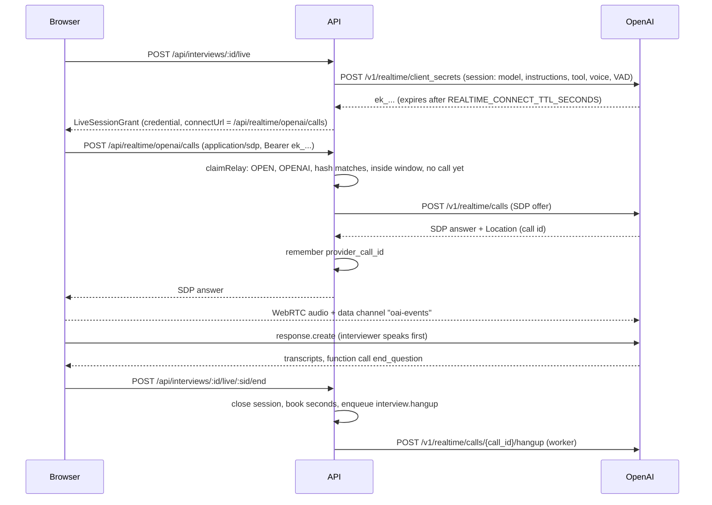

# Low-level design

How the code is organised and how each request travels through it. The big picture is in
[HLD.md](HLD.md); the HTTP contract is in [rest-contract.md](../api/rest-contract.md).

## 1. API layers

Pattern: routes, controllers, services, repositories and presenters, with integrations at
the edge ([ADR 0001](adr/0001-monorepo-stack.md)).

| Layer | Folder | Rule |
| --- | --- | --- |
| Routes | `apps/api/src/routes/*.routes.ts` | Mount path, guards (`authenticate`, `rateLimit`) and a doc comment per endpoint. `scripts/gen-openapi.ts` reads these files and [`routes/index.ts`](../../apps/api/src/routes/index.ts) |
| Controllers | `apps/api/src/controllers` | Parse input with strict zod schemas (`core/validate.ts`), call one service, write the response. No business rules |
| Services | `apps/api/src/services` | Business rules and transactions. Take an `Actor`, never an Express request, so jobs and tests can call them |
| Repositories | `apps/api/src/repositories` | Reusable queries (users, sessions, tokens, audit, keyset cursors) |
| Presenters | `apps/api/src/presenters` | Database rows to DTOs from `packages/types` |
| Integrations | `apps/api/src/integrations` | Text model adapters (`llm/`), realtime adapters (`realtime/`), mail, Redis, resume extraction |
| Jobs | `apps/api/src/jobs` | Named handlers with typed payloads (`registry.ts`) |

Side effects that must wait for a commit (enqueueing a job) go through `Effects` in
[`core/effects.ts`](../../apps/api/src/core/effects.ts): `withTransaction(fn)` hands the
function a transaction and an `Effects` collector, and jobs are enqueued only after the
commit. A rolled-back transaction enqueues nothing.

### The interview module

| File | Responsibility |
| --- | --- |
| [`services/interview/interview.service.ts`](../../apps/api/src/services/interview/interview.service.ts) | Create from resume or job description, list, read, edit plan, replan, delete, finish, submit answers, record proctoring events. `ownedInterview` is the owner gate |
| [`services/interview/live.service.ts`](../../apps/api/src/services/interview/live.service.ts) | Mint live sessions, end them, the sweeper, the relay gate (`claimRelay`), hang-up |
| [`services/interview/sessions.ts`](../../apps/api/src/services/interview/sessions.ts) | Close a session and book its server-measured seconds |
| [`services/interview/plan.ts`](../../apps/api/src/services/interview/plan.ts) | Plan bounds, schema, normalisation, positions |
| [`services/interview/prompts.ts`](../../apps/api/src/services/interview/prompts.ts) | Planner, interviewer and scorer prompts, `fence()`, the `end_question` tool |
| [`services/interview/ai.ts`](../../apps/api/src/services/interview/ai.ts) | `generateJson`: one structured text-model call with a retry and usage booking |
| [`services/interview/report.service.ts`](../../apps/api/src/services/interview/report.service.ts) | Reports, averages in SQL |
| [`services/interview/pdf.ts`](../../apps/api/src/services/interview/pdf.ts) | The PDF (pdfkit, built-in Helvetica, no transcripts) |
| [`services/share.service.ts`](../../apps/api/src/services/share.service.ts) | Share links |
| [`services/quota.service.ts`](../../apps/api/src/services/quota.service.ts) | Limits, the advisory lock, usage booking |
| [`jobs/interview.jobs.ts`](../../apps/api/src/jobs/interview.jobs.ts) | `interview.plan`, `interview.score`, `interview.hangup`, `interview.sweep` |

## 2. Jobs and schedules

| Job | Queue | Payload | Options | Trigger |
| --- | --- | --- | --- | --- |
| `interview.plan` | interview | `{ interviewId, resumeText? }` | 2 attempts, removed on complete and on fail | Create, replan |
| `interview.score` | interview | `{ answerId, version }` | 3 attempts, removed on complete | Answer submitted |
| `interview.hangup` | interview | `{ sessionId }` | 3 attempts | An OpenAI session with a known call id was closed |
| `interview.sweep` | interview | none | every 60 s | Worker schedule |
| `maintenance.lift-suspensions` | maintenance | none | every 5 min | Worker schedule |
| `maintenance.purge-accounts` | maintenance | none | every 6 h | Worker schedule |
| `maintenance.retention` | maintenance | none | every 6 h | Worker schedule |

Defaults for every queue: 5 attempts, exponential backoff from 5 s. The worker runs the
`interview` queue with concurrency 8 and `maintenance` with 2. With `JOBS_MODE=inline`
the handler runs in the API process right after commit (tests and tiny installs; refused
in production by `assertProductionConfig`).

## 3. Request flows

### 3.1 Create from a resume

`POST /api/interviews/from-resume` (multipart field `file`, optional `proctoring=true`).

1. `multer.memoryStorage()` reads the file into memory, capped at `MAX_RESUME_MB`
   (default 8). Nothing touches disk.
2. `sniffResume` decides the type from the bytes: `%PDF-` for PDF, a ZIP header with a
   `word/` part for DOCX. The file name and browser type are ignored (`400 FILE_TYPE`).
3. `extractResumeText` (unpdf for PDF, mammoth for DOCX) produces plain text, truncated
   to 24,000 characters. Under 200 characters is `422 RESUME_TOO_SHORT` (usually a
   scanned image).
4. A text model must be usable (`503 NO_TEXT_MODEL`).
5. In one transaction: take the user's quota lock, check the monthly interview limit
   (`429 QUOTA_EXCEEDED`), insert the interview in `PLANNING`, book `interviews: 1` in
   `usage_daily`, and enqueue `interview.plan` with the resume text after commit.
6. Respond `201` with the `Interview`. The web app polls `GET /api/interviews/:id`.

### 3.2 Create from a job description

`POST /api/interviews/from-job-description` with `{ company, role, jobDescription,
proctoring? }` (company 1 to 120 characters, role 2 to 120, description 80 to 12,000).
Same transaction as above. The description is stored (`interviews.job_description`) so
the plan can be regenerated with `POST /api/interviews/:id/replan`. Resumes cannot be
replanned (`409 REPLAN_UNAVAILABLE`).

### 3.3 The planner job

`planInterview(interviewId, resumeText?)` in `jobs/interview.jobs.ts`:

1. Acts only on an interview still in `PLANNING` (idempotent).
2. A resume interview without `resumeText` fails at once ("The resume is no longer
   available"): this happens if the job was replayed after its payload was removed.
3. Builds `plannerFromResume` or `plannerFromJobDescription` and calls `generateJson`
   with `plannerOutput` (max 12,000 output tokens, temperature 0.8).
4. `normalisePlan` keeps valid rounds and questions, fills code languages, caps sizes.
5. Sets `READY` with the plan, summary, domain and role (and a title such as
   "Data Engineer interview" for resumes), guarded by `WHERE status = 'PLANNING'`.
6. On any failure: `PLAN_FAILED` with a plain `plan_error`, and books `interviews: -1`
   so the quota is given back.

Details of the prompts and validation: [interview-engine.md](interview-engine.md).

### 3.4 Minting a live session

`POST /api/interviews/:id/live` with an optional `{ round, question }` (defaults to the
interview's current position). `startLive` in `live.service.ts`:

1. Owner check (404 otherwise); `409 INTERVIEW_COMPLETED` or `409 PLAN_NOT_READY`.
2. Resolves the realtime model: the interview's, else the user's default, else the
   deployment default (`503 NO_REALTIME_MODEL`). The voice is the user's preference if
   the model offers it, else the model's first voice.
3. Builds the instructions with `interviewerInstructions` from the stored plan, summary,
   company, role, the interviewer name and house rules from settings, and the user's
   transcription language. Nothing from the request body enters them.
4. In one transaction: take the quota lock, close any other `OPEN` session of this user
   (booking its time), compute `max_seconds` with `voiceSecondsAllowed` (`429
   QUOTA_EXCEEDED` when under 30 seconds are left), insert the `live_sessions` row, and
   set the interview to `IN_PROGRESS` at that position.
5. After commit, call the provider adapter's `mint` (so a slow provider never holds the
   lock). Store the SHA-256 of the credential on the row.
6. Return the `LiveSessionGrant`: `id`, `provider`, `credential`, `model`, `voice`,
   `connectUrl`, `expiresAt`, `maxSeconds`, `question` and, for the stub only, `script`.
7. If minting fails, the row is closed at zero seconds and the call answers `502
   REALTIME_UNAVAILABLE`.

The partial unique index `live_sessions_one_open` makes "one open session per user" a
database guarantee.

### 3.5 OpenAI: WebRTC through the relay, and hang-up

The browser transport ([`apps/web/src/lib/realtime/openai.ts`](../../apps/web/src/lib/realtime/openai.ts))
is plain WebRTC with no SDK. It never sends `session.update`. The relay accepts an SDP
body up to 64 KB, is rate limited to 30 requests a minute per IP, and accepts a credential
only once (the call id is set on first use) and only within its connection window. When
OpenAI answers with an error the relay returns 502. See
[realtime-and-providers.md](realtime-and-providers.md) for why.

### 3.6 Gemini Live

The API calls `authTokens.create` (v1alpha) with `uses: 1`, `newSessionExpireTime` at the
end of the connection window, `expireTime` at the end of the session's allowed length, and
`liveConnectConstraints` carrying the model, system instruction, the `end_question` tool,
the voice and the transcription settings. The grant's credential is the token name.

The browser ([`apps/web/src/lib/realtime/gemini.ts`](../../apps/web/src/lib/realtime/gemini.ts))
opens `@google/genai` live with the token as the API key on `v1alpha`. Microphone audio is
resampled to 16 kHz PCM16 and streamed; the model's 24 kHz PCM16 is scheduled on an
AudioContext and dropped on interruption. To make the interviewer speak first, it sends a
short "(The candidate has joined and is ready.)" turn. Gemini calls are not hung up by the
server; the token's `expireTime` bounds them.

### 3.7 The stub transport

For development and tests without a key. The API signs a `stub_...` token (HMAC with
`JWT_SECRET`) and returns `script`: a greeting (or "Alright, next question.") and the
question text. The browser ([`apps/web/src/lib/realtime/stub.ts`](../../apps/web/src/lib/realtime/stub.ts))
speaks the lines with `speechSynthesis` (silent and quick under automation), and the
candidate types or dictates where the browser offers speech recognition. The stub never
calls `end_question`; the candidate presses Next question. An admin cannot create a stub
provider when `NODE_ENV=production` (`400 STUB_IN_PRODUCTION`), and the starter catalogue
adds it only outside production.

### 3.8 Ending a session

`POST /api/interviews/:id/live/:sid/end` (owner only, `404 LIVE_SESSION_NOT_FOUND`
otherwise). `closeSession` locks the row, computes seconds as
`min(max_seconds, now - created_at)`, marks it `ENDED`, books `voice_seconds` in
`usage_daily`, and queues `interview.hangup` when an OpenAI call id is known. Ending an
already closed session returns its stored seconds (idempotent). The response carries the
minutes left this month.

The room ends a session when the interviewer calls `end_question` (after a 1.2 s pause so
the last words finish), when the candidate presses Next question or Submit code, or when
its countdown from `maxSeconds` reaches zero
([`apps/web/src/components/room/room-view.tsx`](../../apps/web/src/components/room/room-view.tsx)).

### 3.9 Submitting an answer and scoring

`POST /api/interviews/:id/answers` with `{ round, question, transcript? , code?,
language?, advance? }`. The schema is strict, so a body carrying ratings is a `400
VALIDATION_FAILED`.

1. The interview must be `IN_PROGRESS` (`409 INTERVIEW_NOT_IN_PROGRESS`) and the question
   must exist (`400 QUESTION_NOT_FOUND`).
2. The transcript is cleaned: null bytes removed, empty lines dropped, at most the last
   200 lines and 30,000 characters. Code is capped at 40,000 characters. A code question
   with neither code nor transcript is `400 ANSWER_EMPTY`.
3. Upsert on `(interview_id, round_index, question_index)`: answering again replaces the
   transcript, clears the ratings and sets `SCORING`.
4. Unless `advance: false`, move to the next position, or set `COMPLETED` after the last.
5. After commit, enqueue `interview.score` with `version = answers.updated_at`.
6. Respond `202` with the `AnswerResult` in `SCORING`.

`scoreAnswer(answerId, version)` acts only when the row is still `SCORING` and its
`updated_at` equals `version`, and writes with the same condition. A stale job (the answer
was replaced) does nothing. See [interview-engine.md](interview-engine.md) for the rubric
and the floor for empty answers.

### 3.10 Report and PDF

`GET /api/interviews/:id/report` builds `InterviewReport` on read: per-round and overall
averages computed in SQL over `SCORED` answers only (an unscored answer is not a zero),
every question with its answer, the transcript and code (owner only), total voice seconds
from `live_sessions`, and up to 500 proctoring events when proctoring is on.

`GET /api/interviews/:id/report.pdf` renders the same report with pdfkit (A4, built-in
Helvetica, characters outside Latin-1 replaced). It leaves transcripts out. 30 per hour
per user, and `404` when the `pdfExport` feature is off.

### 3.11 Shares

`POST /api/interviews/:id/shares` with `{ includeTranscript?, expiresInDays? }` (1 to
365). The id is a ULID, a dash and 22 random base64url characters. At most 10 active
links per interview (`403 SHARE_LIMIT`). `GET /api/shared/:id` is public: it increments
`view_count` in the same `UPDATE` that checks "not revoked and not expired", then builds
the report with the transcript only if the owner included it. Unknown, malformed, revoked
and expired links are all the same `404 SHARE_NOT_FOUND`. With the `sharing` feature off,
links cannot be created and existing ones answer 404 until it is back on.

### 3.12 Proctoring events

When the interview has `proctoring` on, the browser
([`apps/web/src/lib/realtime/proctor.ts`](../../apps/web/src/lib/realtime/proctor.ts))
runs the MediaPipe face detector from this origin (`/mediapipe/wasm`,
`/mediapipe/blaze_face_short_range.tflite`) on one frame every 1.5 s. A state must hold
for 3 s before it becomes an event (`NO_FACE`, `MULTIPLE_FACES`, `FACE_BACK`). Tab
visibility adds `TAB_HIDDEN` and `TAB_VISIBLE`. Events are batched every 10 s and when
the tab hides, up to 100 per request.

`POST /api/interviews/:id/proctor-events` is owner only, `409 PROCTORING_OFF` when the
interview has proctoring off, and ignored (0 recorded) before the interview starts or
after it ends. A browser timestamp in the future or before the start is replaced by the
server time. At most 2,000 events are kept per interview.

### 3.13 The sweeper

`interview.sweep` runs every 60 s. It selects up to 500 `OPEN` sessions whose
`expires_at` has passed and closes each as `EXPIRED`, booking the full `max_seconds`
(the browser never reported an end, so the server assumes the worst). `expires_at` is set
at mint time to `created_at + REALTIME_CONNECT_TTL_SECONDS + max_seconds +
REALTIME_GRACE_SECONDS`. Closing an OpenAI session with a known call id queues a hang-up.

## 4. Web app

| Path | Page |
| --- | --- |
| `/` | Landing when signed out; home when signed in (start, recent interviews, usage) |
| `/new` | Resume upload or job description form |
| `/i/[id]` | Interview: planning status, plan review and editing, start or resume |
| `/room/[id]` | The live room |
| `/i/[id]/report` | Report, PDF download, share links |
| `/s/[id]` | Public shared report |
| `/settings` | Tabs: Interviews (voice model, voice, transcription language, proctoring default, this month's usage), Shared links, Appearance, Account (profile, security, sessions, export, delete) |
| `/admin/*` | Overview, users, quotas, models, interviews, shares, settings, audit |

The room is a state machine (`preflight`, `connecting`, `live`, `submitting`, `between`,
`done`). Preflight asks for the microphone with echo cancellation, noise suppression and
auto gain (and the camera when proctoring is on), or lets the candidate continue by
typing. The transports share one interface
([`apps/web/src/lib/realtime/types.ts`](../../apps/web/src/lib/realtime/types.ts)) and are
loaded on demand.

Runtime configuration reaches the browser through `/env.js`, rendered per request from the
container environment ([`apps/web/src/lib/runtime-env.ts`](../../apps/web/src/lib/runtime-env.ts)),
so one image serves every environment. The CSP is set per request in
[`apps/web/src/middleware.ts`](../../apps/web/src/middleware.ts) ([security.md](security.md)).

## 5. Rate limits

Limits use Redis (shared by every API task) with an in-memory fallback during a Redis
outage ([`middleware/rate-limit.ts`](../../apps/api/src/middleware/rate-limit.ts)). Keyed by
user when signed in, by IP otherwise.

| Name | Budget | Key |
| --- | --- | --- |
| `auth` (signup, login, verify, reset, change password, TOTP) | 10 per minute | IP |
| `auth-mail` (resend verification, forgot password) | 5 per hour | IP |
| `auth-refresh` | 60 per minute | IP |
| `interview-create` (resume and job description share one budget) | 10 per hour | user |
| `interview-replan` | 5 per hour | user |
| `interview-live` | 40 per hour | user |
| `interview-answer` | 120 per hour | user |
| `interview-proctor` | 300 per hour | user |
| `interview-pdf` | 30 per hour | user |
| `share-create` | 30 per hour | user |
| `shared-read` | 120 per minute | IP |
| `realtime-relay` | 30 per minute | IP |
| `account-delete` | 5 per hour | user |
| `account-export` | 3 per day | user |
| `admin-erase` | 20 per hour | user |
| `admin-model-test` | 20 per minute | user |

Sign-in also has failure budgets: 5 per account and IP per 15 minutes, 50 per account per
hour. `RATE_LIMITS=off` disables all limits (the default under `NODE_ENV=test`).

## 6. Errors

Services throw `HttpError` subclasses from [`core/errors.ts`](../../apps/api/src/core/errors.ts).
The error handler in [`app.ts`](../../apps/api/src/app.ts) answers
`{ error, code, details?, requestId }`. Body parser errors become `400 BAD_REQUEST` or
`413 PAYLOAD_TOO_LARGE` (JSON bodies are capped at 2 MB). Anything unexpected is logged
with the request id and answered `500 INTERNAL` without the underlying message.
