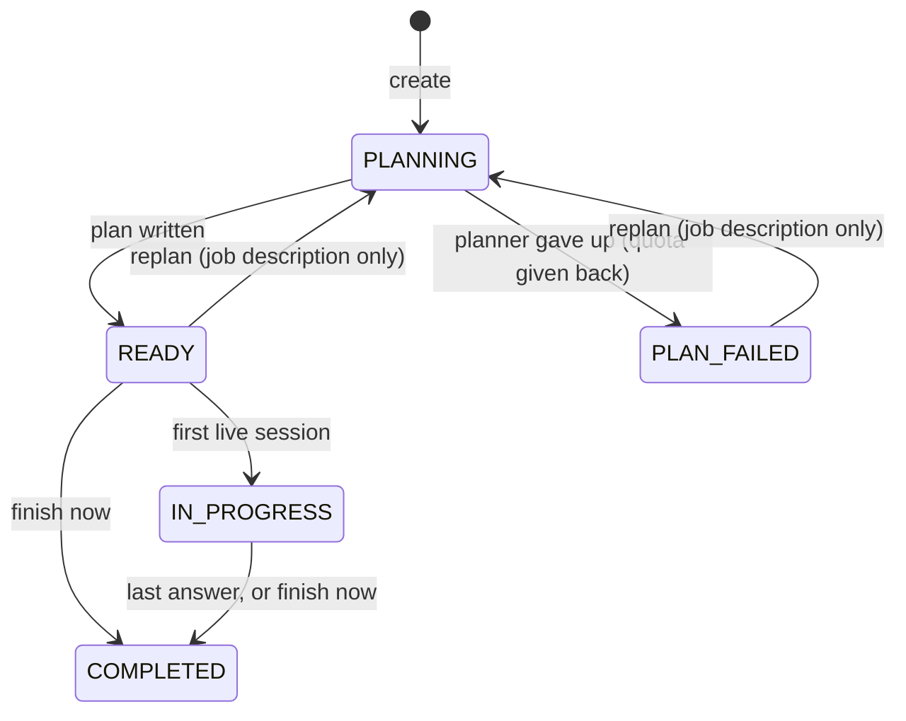

# Data model

The whole schema is one migration, [`db/migrations/0001_init.sql`](../../db/migrations/0001_init.sql).
Kysely types are in [`apps/api/src/db/types.ts`](../../apps/api/src/db/types.ts).

## Conventions

- Primary keys are ULIDs stored as `text` (sortable by creation time). Provider ids are
  slugs; share ids are a ULID plus a random suffix.
- Timestamps are `timestamptz(3)` and the API runs with `TZ=UTC`. Millisecond precision
  matches a JS `Date`, so keyset cursors round-trip exactly.
- Lists page with keyset cursors on `(created_at, id)`, never `OFFSET`.
- No tenant column: one deployment serves one organisation ([ADR 0002](adr/0002-single-tenant.md)).
- Provider API keys are never in the database ([ADR 0004](adr/0004-text-model-adapters.md)).
- Resume files are never stored; only the summary and plan the model wrote from them
  ([ADR 0005](adr/0005-resumes-never-stored.md)).
- Usage rows hold counts, seconds and model ids, never text ([ADR 0006](adr/0006-monthly-quotas-counts-only-usage.md)).
- Extensions: `citext` (case-insensitive email and username), `pg_trgm` (admin user search).

## Enums

| Enum | Values |
| --- | --- |
| `user_role` | `USER`, `ADMIN` |
| `user_status` | `PENDING_VERIFICATION`, `ACTIVE`, `SUSPENDED`, `BANNED`, `DEACTIVATED` |
| `auth_token_type` | `VERIFY_EMAIL`, `RESET_PASSWORD` |
| `provider_kind` | `OPENAI`, `ANTHROPIC`, `GEMINI`, `OPENAI_COMPATIBLE`, `STUB` |
| `model_kind` | `TEXT` (plans and scoring), `REALTIME` (live voice) |
| `interview_source` | `RESUME`, `JOB_DESCRIPTION` |
| `interview_status` | `PLANNING`, `PLAN_FAILED`, `READY`, `IN_PROGRESS`, `COMPLETED` |
| `answer_kind` | `VOICE`, `CODE` |
| `answer_status` | `SCORING`, `SCORED`, `FAILED` |
| `live_status` | `OPEN`, `ENDED` (closed by the browser or the server on request), `EXPIRED` (closed by the sweeper) |
| `proctor_event_kind` | `NO_FACE`, `MULTIPLE_FACES`, `FACE_BACK`, `TAB_HIDDEN`, `TAB_VISIBLE`, `CAMERA_OFF` |

The web client sends `CAMERA_OFF` once when a proctored interview starts without a camera, so the
report explains why there are no face events.

## Interview status

## Identity

### `quota_tiers`

Monthly allowances. `NULL` means unlimited.

| Column | Notes |
| --- | --- |
| `id`, `name` (unique, 1 to 60) | |
| `monthly_interviews`, `monthly_voice_minutes` | `>= 0` or `NULL` |
| `max_session_minutes` | 1 to 120, default 15: the longest one live session may run |
| `is_default` | exactly zero or one default (partial unique index `quota_tiers_one_default`) |

Seeded: `Default` with 8 interviews, 120 voice minutes, 15-minute sessions.

### `users`

| Column | Notes |
| --- | --- |
| `email` (citext, unique), `username` (citext, unique, 3 to 40 of letters, digits and dashes) | |
| `display_name` | 1 to 80, cleaned at write time (never an email or phone number) |
| `password_hash` | bcrypt |
| `role`, `status` | |
| `email_verified_at` | |
| `totp_secret` | AES-256-GCM ciphertext; `totp_enabled`; `totp_last_step` (a code works once) |
| `suspended_until` | |
| `token_version` | bumped by "sign out everywhere"; access tokens carry it |
| `quota_tier_id` | `NULL` = the default tier |
| `deletion_requested_at` | the purge job erases the account 14 days later unless they sign in |
| `last_seen_at`, `created_at`, `updated_at` | |

Indexes: a trigram index over name, username and email for admin search; a partial index
on non-`USER` roles.

### `sessions`

Refresh-token sessions. `token_hash` is the SHA-256 of the refresh token (unique);
`family_id` groups every rotation of one login so a replayed token can revoke the family.
Also `user_agent`, `ip`, `last_used_at`, `expires_at`, `revoked_at`, `replaced_by`.

### `auth_tokens`

Email verification and password reset tokens: `type`, `token_hash` (unique),
`expires_at`, `used_at`.

### `totp_recovery_codes`

Ten single-use codes per user, stored as an HMAC keyed from `TOTP_ENCRYPTION_KEY`.
Primary key `(user_id, code_hash)`.

### `user_preferences`

One row per user (a missing row means the defaults).

| Column | Default |
| --- | --- |
| `voice` | `alloy` (ignored when the model lacks it) |
| `transcription_language` | `auto`, or an ISO-639-1 code |
| `proctoring_default` | `false` |
| `default_realtime_model_id` | `NULL` (FK to `models`, set null on delete) |

## Providers and models

### `providers`

| Column | Notes |
| --- | --- |
| `id` | the slug, 3 to 40 lowercase letters, digits and dashes; also the key name in `PROVIDER_KEYS` |
| `kind` | `provider_kind` |
| `display_name`, `base_url` (up to 300), `enabled` | |

### `models`

The one catalogue the runtime reads.

| Column | Notes |
| --- | --- |
| `provider_id` | cascade on provider delete |
| `kind` | `TEXT` or `REALTIME` |
| `model_ref` | the provider's model id |
| `display_name`, `description` | |
| `max_output_tokens` | default 8192 |
| `voices` | `text[]`, realtime only, the first is the default |
| `input_usd_per_mtok`, `output_usd_per_mtok`, `usd_per_minute` | optional, for the admin cost estimate only |
| `enabled`, `is_default`, `sort_order` | one default per kind (`models_one_default_per_kind`) |

Unique `(provider_id, model_ref, kind)`.

## Interviews

### `interviews`

| Column | Notes |
| --- | --- |
| `user_id` | owner; cascade on user delete |
| `source`, `status` | |
| `title` (1 to 160), `company`, `role` (up to 120), `domain` (up to 120) | |
| `summary` | up to 2,000: the candidate (from a resume) or the job (from a JD); never the full resume |
| `job_description` | up to 12,000, kept so the plan can be regenerated; `NULL` for resumes |
| `plan` | `jsonb` round list ([interview-engine.md](interview-engine.md)); frozen once the first live session opens |
| `plan_error` | up to 300, a plain reason |
| `proctoring` | |
| `text_model_id`, `realtime_model_id` | set null on model delete |
| `current_round`, `current_question` | the next question to ask |
| `started_at`, `completed_at` | |

Indexes: `(user_id, created_at DESC, id DESC)` for the owner's list,
`(created_at DESC, id DESC)` for admin, `(user_id, created_at)`.

### `answers`

One row per question, unique `(interview_id, round_index, question_index)`. Answering
again replaces the row's content and scores it again.

| Column | Notes |
| --- | --- |
| `kind` | `VOICE` or `CODE` |
| `transcript` | `jsonb` `[{ role: "interviewer" \| "candidate", text }]`, as transcribed in the browser |
| `code` (up to 40,000), `language` | code answers |
| `status` | `SCORING`, `SCORED`, `FAILED` |
| `domain_rating`, `communication_rating` | 1 to 100, written only by the scoring job |
| `feedback` | `jsonb` `{ strengths, weaknesses, suggestions, analysis, correctedSnippet }` |
| `scored_at`, `updated_at` | `updated_at` is the version the scoring job checks |

### `live_sessions`

One realtime connection, one question.

| Column | Notes |
| --- | --- |
| `interview_id`, `user_id`, `model_id`, `provider_kind` | |
| `round_index`, `question_index` | |
| `status` | `OPEN`, `ENDED`, `EXPIRED` |
| `credential_hash` | SHA-256 of the minted credential; the relay matches on it. Never the value |
| `provider_call_id` | OpenAI call id from the relayed SDP answer, for hang-up |
| `max_seconds`, `seconds` | the cap, and the server-measured time booked at close |
| `created_at`, `expires_at`, `ended_at` | `expires_at` = connect window + `max_seconds` + grace |

Indexes: `live_sessions_one_open` (unique on `user_id` where `status = 'OPEN'`: one open
session per user), by interview, by user and month, and by `credential_hash` where open.

### `proctor_events`

What the browser's proctoring reported: `kind`, optional `round_index` and
`question_index`, `occurred_at` (browser time, corrected by the server when implausible).
Indexed by `(interview_id, occurred_at)`. At most 2,000 per interview.

### `shares`

A read-only link to one interview's report.

| Column | Notes |
| --- | --- |
| `id` | the public token: ULID, dash, 22 random base64url characters |
| `user_id`, `interview_id` | cascade on delete |
| `include_transcript` | the owner's choice |
| `view_count` | incremented on each read |
| `revoked_at`, `revoked_by` | owner or admin |
| `expires_at` | optional |

## Quotas and usage

### `user_quota_overrides`

One user's numbers on top of their tier: `monthly_interviews`, `monthly_voice_minutes`
(each `NULL` falls back to the tier), `note`, `updated_by`.

### `usage_daily`

Primary key `(user_id, day, model_id)`, UTC days.

| Column | Booked by |
| --- | --- |
| `calls`, `input_tokens`, `output_tokens` | every text-model call (planning, scoring) |
| `interviews` | `+1` when an interview is created (against its text model), `-1` when its plan fails, `+1` again on a replan after failure |
| `voice_seconds` | closing a live session |

Deleting an interview does not touch this table, so it does not give quota back
([quotas.md](quotas.md)).

## Operations

### `settings`

Key-value `jsonb` deployment settings (`AppSettings`): name, tagline, registration mode
and allowed domains, support email, interviewer name and house rules, feature switches,
retention days, minimum app version.

### `audit_log`

`actor_id` (null for the system), `action` (such as `user.purged`, `retention.applied`),
`entity_type`, `entity_id`, `ip`, `data` (`jsonb`). Indexed by time, by entity and by
actor.

## What is deleted when

| Event | Effect |
| --- | --- |
| User deletes an interview | The interview and, by cascade, its answers, live sessions, proctoring events and shares. `usage_daily` stays |
| Account deletion requested | Signed out everywhere; after 14 days the purge job anonymises the identity and deletes every interview, answer, transcript and share |
| Admin erases an account | The same, at once |
| Retention set (`retentionDays`) | Interviews older than that are deleted every 6 hours |
| Model deleted | Its `usage_daily` rows cascade; interviews and live sessions keep a null model |
